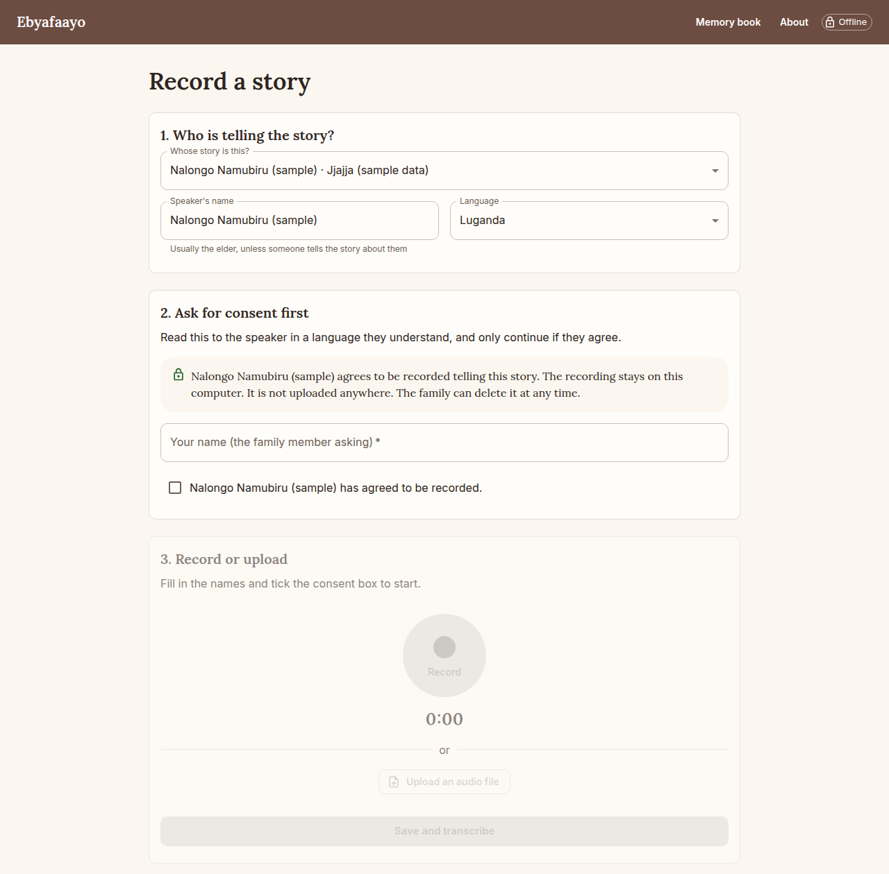
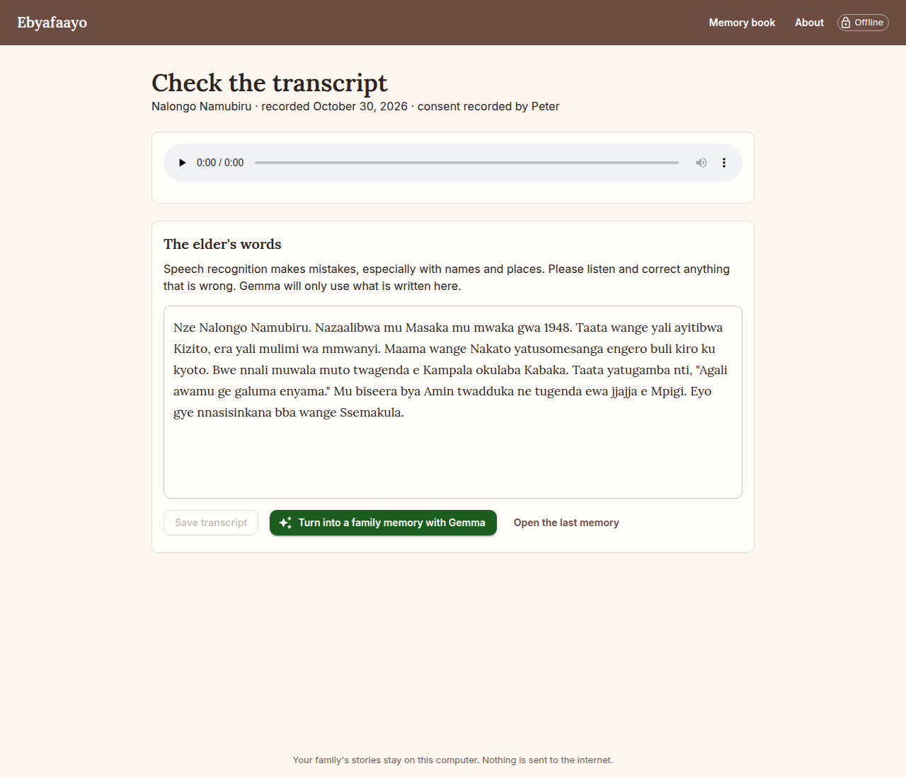
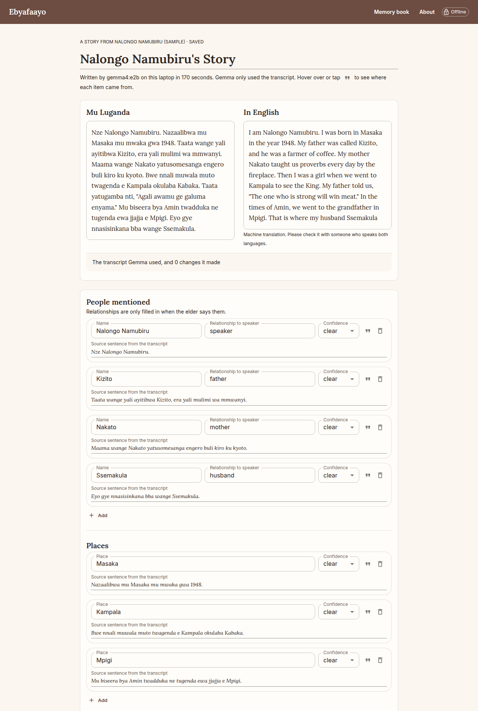
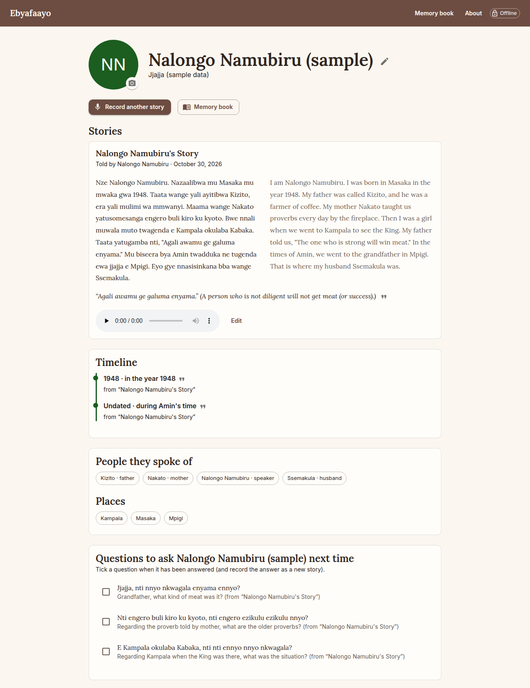
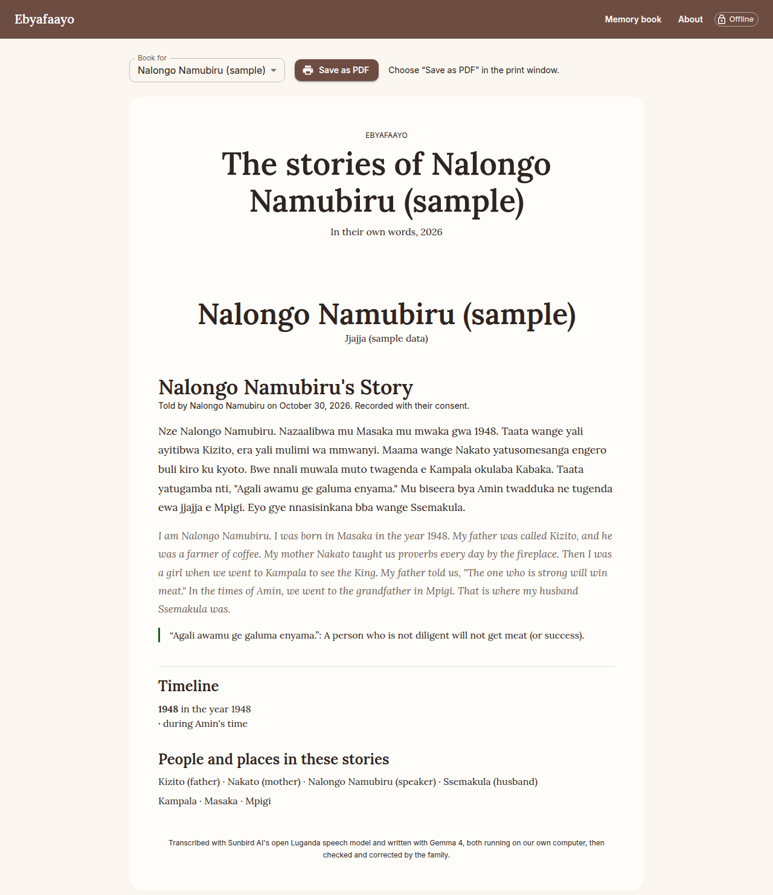
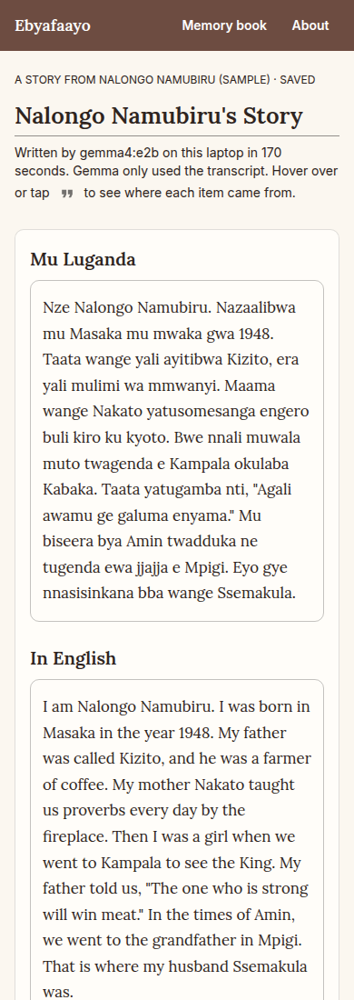
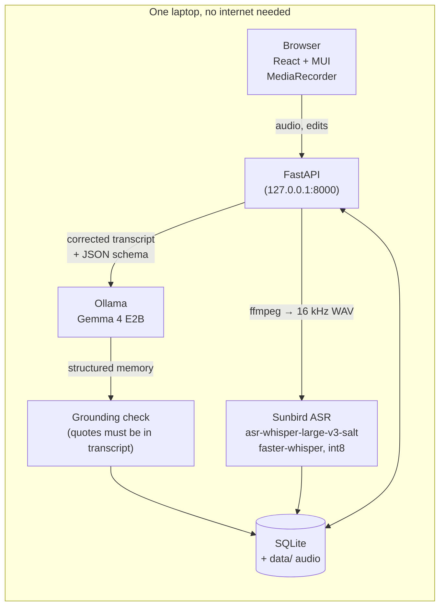

# Ebyafaayo

**An offline family oral-history keeper for Luganda speakers.** Record an elder telling a story, get a transcript from an open Luganda speech model, correct it together, and let Gemma 4 (running on your own laptop) turn it into a family memory: the story in clean Luganda, an English translation, the people, places and times mentioned, and gentle questions to ask next time. Every story goes onto a remembrance page for that elder and into a printable memory book.

Nothing leaves the computer. No cloud AI, no analytics, no telemetry.

*Ebyafaayo* is Luganda for history: the things that happened.

Built for the DEV Hacktoberfest Open-Source AI Challenge, Week 4: "Ghost in the Machine".

## The story behind it

> _TODO (Peter): why this matters to you and your family._

## What it does

1. **Consent first.** Before recording, the family reads a short consent statement to the elder, notes who asked, and ticks a box. The consent is stored with the recording.
2. **Record or upload** a story in Luganda (or another of the 11 languages the Sunbird model knows).
3. **Transcribe** with Sunbird AI's open Luganda Whisper model, on the laptop's CPU.
4. **Review together.** The audio plays next to the transcript, and the family corrects it. Gemma only ever sees the corrected text.
5. **Structure with Gemma 4.** Title, Luganda text (only obvious fixes, each listed), English translation, people and how they are related to the speaker, places, time periods, ekika (clan) and omuziro (totem) only if the elder says them, engero (proverbs), and 3 to 5 follow-up questions in Luganda and English.
6. **Every item is linked to its source sentence**, shown on hover or tap. The app checks Gemma's quotes against the transcript itself: items it cannot find are flagged in amber, and a clan or totem that is not in the transcript is removed.
7. **Everything is editable** before it is saved.
8. **Remembrance page** for each elder: stories in order, a timeline, the people and places they spoke of, and the questions still to ask.
9. **Memory book:** a print-friendly page for one elder or the whole family. Save it as a PDF from the browser.

### Screenshots

These use a short **sample** story written for testing, not a real family's story. The transcript was typed in, and Gemma 4 E2B produced everything else on the development laptop.

| Consent before recording | Checking the transcript |
|---|---|
|  |  |

| The memory Gemma wrote; every item links to its sentence | Remembrance page with timeline |
|---|---|
|  |  |

| Memory book (print / save as PDF) | On a phone |
|---|---|
|  |  |

## How it works



- **Speech to text:** `Sunbird/asr-whisper-large-v3-salt`, converted once to CTranslate2 int8 (`scripts/convert_asr.py`) and run with faster-whisper. Long recordings are cut into pieces of at most 30 seconds, at the quietest moment near each cut. The language token comes from the Sunbird model card (Luganda = token 50355); the conversion script maps it through the model's own tokenizer.
- **Structuring:** Gemma 4 through Ollama's local HTTP API, in two focused calls: one writes the clean Luganda and the English translation ([`structure_text.md`](backend/prompts/structure_text.md)), the other notes the people, places, times, proverbs, clan, totem and follow-up questions ([`structure_extract.md`](backend/prompts/structure_extract.md)). When we asked Gemma E2B for everything in one call, it sometimes returned every list empty. Each call uses Ollama structured outputs: a JSON schema generated from the Pydantic model, with every field required and a maximum length for every string and list, so a looping model cannot write forever. Pydantic validates the result, with one "fix this JSON" retry.
- **Grounding check** ([`backend/app/grounding.py`](backend/app/grounding.py)): every person, place, time, proverb, clan and totem must quote a sentence that is really in the transcript, and names must actually appear in it. Matching quotes are replaced with the exact transcript sentence, unmatched items are marked "unclear" and highlighted, and an unmatched clan or totem is dropped.
- **One heavy job at a time:** an 8 GB laptop cannot hold both models, so the app unloads Gemma before transcribing and drops the speech model afterwards.

## Why open models

- **It works offline.** Many families do not have reliable internet, and stories are often recorded at the village home.
- **Family stories stay private.** Recordings of elders, clan details and family relationships never leave the laptop.
- **It is free to run.** There is no API bill, so a family can record as many stories as they like.
- **It can grow.** Sunbird's open model already covers 10 Ugandan languages plus English. Open weights mean the community can keep improving them, and this app can switch to better models without asking anyone's permission.

## Setup

Requirements: Linux or macOS, Python 3.11+, Node 20+, ffmpeg, [Ollama](https://ollama.com/download), about 8 GB of free disk space at peak.

```bash
git clone https://github.com/Nuwahereza-eng/ebyafaayo && cd ebyafaayo
make setup                  # Python venv, web app build
make gemma                  # ollama pull gemma4:e2b (4.6 GB)

# The Sunbird model is gated (approval is automatic):
# accept the terms at https://huggingface.co/Sunbird/asr-whisper-large-v3-salt, then
.venv/bin/hf auth login
make asr-model              # downloads 6.2 GB, converts to 1.6 GB int8, deletes the original

make run                    # open http://127.0.0.1:8000
```

Without the speech model, the app still works: the family listens to the recording and types the transcript.

To use a bigger Gemma: `make gemma run GEMMA=gemma4:e4b`.

### Hardware notes

| Gemma 4 model | Ollama download | RAM it needs (roughly) | Notes |
|---|---|---|---|
| `gemma4:e2b` | 4.6 GB | ~4 GB free | Default. Works on an 8 GB laptop if the browser is not too heavy. |
| `gemma4:e4b` | 6.6 GB | ~6 GB free | Better Luganda and translation; needs 16 GB RAM. |
| `gemma4:26b` | 19 GB | ~20 GB free | Desktop or workstation. |
| `gemma4:31b` | 20 GB | ~22 GB free | Desktop or workstation. |

The Sunbird speech model needs about 1.5 GB of RAM in int8.

**Speed on the development laptop** (ThinkPad T470s, Intel i5-7300U, 4 threads, 8 GB RAM, no GPU):

| Step | Time | Notes |
|---|---|---|
| Gemma 4 E2B structuring, ~450-character story (8 sentences) | **170–235 s** | Two calls: about 70 s for the clean Luganda + English, the rest for extraction. Includes loading Gemma (about 25 s) the first time. |
| Sunbird ASR transcription | _not measured yet_ | Needs the Hugging Face login and more free disk space first. |

Gemma's time grows with the length of the story, so a 3-minute story will take several minutes. The app shows progress and you can leave the page and come back.

## Limitations

- **Luganda transcription makes mistakes**, especially with names, places and words borrowed from other languages. That is why the family reviews every transcript.
- **The English translation can be badly wrong, and it is the part we cannot check automatically.** Gemma E2B is a small model. In our tests on a sample story it translated "Eyo gye nnasisinkana bba wange Ssemakula" ("That is where I met my husband Ssemakula") once as "my husband Ssemakula was killed" and once as "my grandfather Ssemakula". It also got the meaning of the proverb "Agali awamu ge galuma enyama" (teeth that are together bite the meat, meaning unity is strength) wrong every time. Treat the translation as a first draft, and check it with someone who speaks both languages. A larger Gemma (E4B or 26B) should do better if your computer has the RAM.
- **The Luganda follow-up questions are often awkward or ungrammatical** with E2B; the English versions are usually fine. The app tells the family to fix the wording before asking.
- **Clan and totem are only recorded when the elder says them.** The app never fills them in from general knowledge.
- **The grounding check is a safety net, not a guarantee.** It catches quotes and names that are not in the transcript, but it cannot judge whether a relationship was understood correctly. People still need to read and check.
- **The timeline** only places events that mention a year; others are listed as undated.
- It runs on one computer for one family. There are no accounts or sync.

## Gemma 4 audio test

Not done. Gemma 4 E2B in Ollama only accepts text and images (no audio), and testing it through `transformers` would need a second ~10 GB download of the full model. The development laptop has neither the disk space nor the RAM. We cut this optional test, as planned, rather than leave the core app unfinished.

## Credits and licences

**Our code:** MIT licence (see [LICENSE](LICENSE)).

**Models (not part of this repository, each under its own licence):**

- [Gemma 4](https://ai.google.dev/gemma) by Google DeepMind. Open weights under the [Gemma Terms of Use](https://ai.google.dev/gemma/terms).
- [Sunbird/asr-whisper-large-v3-salt](https://huggingface.co/Sunbird/asr-whisper-large-v3-salt) by [Sunbird AI](https://sunbird.ai), MIT licence. Fine-tuned from [OpenAI Whisper large-v3](https://huggingface.co/openai/whisper-large-v3) (Apache 2.0) on the [SALT](https://huggingface.co/datasets/Sunbird/salt) dataset.

**Open-source software we build on:** [Ollama](https://ollama.com) (MIT), [faster-whisper](https://github.com/SYSTRAN/faster-whisper) and [CTranslate2](https://github.com/OpenNMT/CTranslate2) (MIT), [Hugging Face Transformers](https://github.com/huggingface/transformers) (Apache 2.0, used only for the one-time model conversion), [FastAPI](https://fastapi.tiangolo.com) (MIT), [SQLModel](https://sqlmodel.tiangolo.com) (MIT), [React](https://react.dev) (MIT), [Vite](https://vite.dev) (MIT), [Material UI](https://mui.com) (MIT), [ffmpeg](https://ffmpeg.org) (LGPL/GPL, called as a separate program), [Lora](https://github.com/cyrealtype/Lora-Cyrillic) and [Inter](https://rsms.me/inter/) fonts (SIL Open Font License) via [Fontsource](https://fontsource.org).

The language-token table in `scripts/convert_asr.py` is copied from the Sunbird model card.

This project was built with the help of an AI coding agent (Claude Code); see [docs/agent-log.md](docs/agent-log.md).
